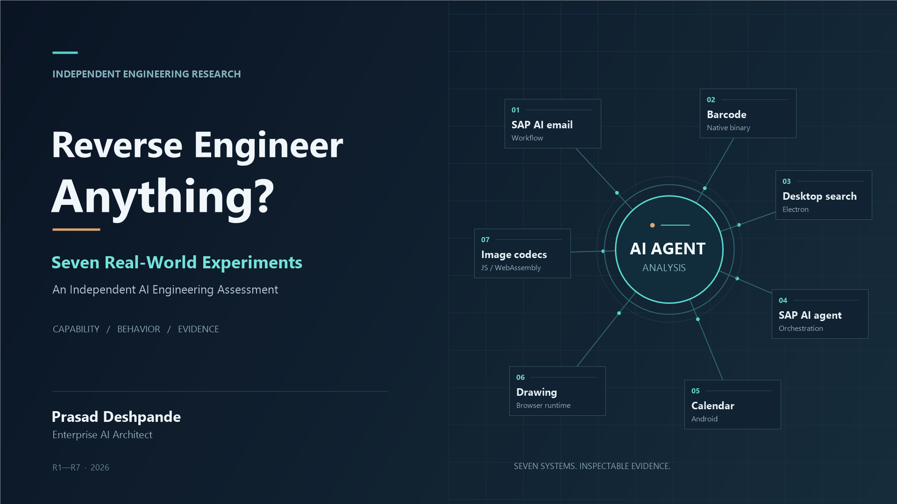

# Reverse Engineer Anything: seven application studies

**REA demonstrated useful scoped analysis and retained evidence. These studies did not establish a REA-specific functional reconstruction advantage.** This is an independent engineering research portfolio by Prasad Deshpande, evaluated with multiple recorded REA builds and execution configurations. It is not affiliated with, endorsed by, or a certification of REA or the application maintainers. [Assessment](consolidated/ENTERPRISE-ARCHITECT-VERDICT.md)

Reverse Engineer Anything (REA) exposes specialist software-analysis facilities to AI agents and returns structured, retained observations. This work asked whether adding it helped Codex explain unfamiliar delivered software and reconstruct selected behavior. Seven applications exposed JavaScript, native, Electron, SAP workflow, Android, browser and WebAssembly boundaries. The selection was deliberate and is not statistically representative. [Method](RESEARCH-METHODOLOGY.md)

## Start here

- [Consolidated research report](consolidated/REA-R1-R7-CONSOLIDATED-FINAL-REPORT.md)
- [Independent evidence review](consolidated/REA-R1-R7-INDEPENDENT-REVIEW.md)
- [Capability coverage](consolidated/CAPABILITY-COVERAGE.md) and [effectiveness matrix](consolidated/EFFECTIVENESS-MATRIX.md)
- [Evidence accounting and availability](EVIDENCE-INDEX.md)
- [LinkedIn article](publication/LINKEDIN-ARTICLE.md), [launch post](publication/LINKEDIN-LAUNCH-POST.md) and [cover assets](publication/assets/REA-LINKEDIN-COVER-SOURCE.svg)
- [Release checklist](release/RELEASE-CHECKLIST.md) and [freeze status](consolidated/FREEZE-STATUS.json)

## Recorded outcomes

| Study | Bounded recorded outcome | Qualification |
|---|---|---|
| [R1 SAP GenAI Mail Insights](experiments/R1-sap-genai-mail/README.md) | A/C 8/8 handler cases; no B arm | Launcher provenance exception remains |
| [R2 Zint GS1-128](experiments/R2-zint/README.md) | A/B/C 48/48 exit and module comparisons | Qualified bounded POC; package/source identity caveat |
| [R3 Joplin semantic search](experiments/R3-joplin/README.md) | A/B/C 40/40 deterministic search cases | REA core analysis timed out; peripheral call succeeded |
| [R4 SAP AI160](experiments/R4-sap-ai160/README.md) | A/B/C 12/12 helper cases | Timestamp helper, not complete SAP agent equivalence |
| [R5 Fossify Calendar](experiments/R5-fossify-calendar/README.md) | A/B/C 32/44 scenarios; recurrence projections 44/44 | Twelve reminder-bearing cases missed by all arms |
| [R6 Excalidraw](experiments/R6-excalidraw/README.md) | A 3/36, B 30/36, C 27/36 | **INVALID_COMPARISON**; counts are not a valid ranking |
| [R7 Squoosh](experiments/R7-squoosh/README.md) | All 26/26 positive workflows; raw A/B 30/30, C 29/30 | C29 grading false negative preserved separately |

Each study link opens its source report, results and limitations. The denominators describe different features and must not be pooled into a general accuracy score. [Claims register](consolidated/CLAIMS-REGISTER.md)

## Independent AI-model challenge: Claude and Gemini

After the seven experiments closed, the owner asked **Claude** and **Gemini** to challenge the methods, numerical claims and Enterprise AI Architect interpretation. Both returned **`APPROVE_WITH_QUALIFICATIONS`** for a carefully qualified research article. These are **external AI-model critiques**, independent of the REA maintainers, **not human peer review, independent laboratory replication or a new experimental run**. Their conclusions do not change any frozen result or the `FINAL_FREEZE_HOLD` disposition.

| Reviewer | Review supplied | Main comments |
|---|---|---|
| **Claude** | Reported cloning this repository at `8286954`, checking **827 public indexed file identities** and the CMS index signature, and recomputing selected retained behavioral scores. | The design has **one selected run per arm**, substantial ceiling effects and uneven treatment/recovery histories; R3/R4 did not demonstrate REA analysis of the scored core; R5 is the clearest sub-ceiling direct-tool comparison; REA encountered oversized/irrelevant responses, timeouts and substantial context consumption. Public evidence is a subset of the owner-local inventory. |
| **Gemini** | Reviewed the seven-case findings and methodological implications in a separate model-generated assessment. | Agreed that REA's orchestration/evidence value is more defensible than a functional-accuracy advantage; highlighted limited replication, score rubric differences, the invalid R6 comparison, the R7 grader false negative, and token/latency overhead. Some proposed causal and enterprise-adoption statements went beyond the available experimental controls. |

### Corrections accepted after reviewing both critiques

- **R2 grading:** The **40-item rubric is not a 40-item architecture-only score**; it also includes behavioral recovery facts. On its **eight-item architecture subset**, A/B/C recovered **6/8, 6/8 and 7/8** fully supported facts. The extra C rubric items were not established as REA-only discoveries.
- **R5 architecture:** A common **14-item rubric did exist**. A/B/C had **9/14, 10/14 and 8/14** fully supported items, respectively. All arms still scored **32/44** complete behavioral scenarios and missed the same twelve reminder cases; A had an additional unsorted-reminder detail miss.
- **Core-treatment fidelity:** R3's successful REA call concerned a **490-byte peripheral file**, while its primary search-core analysis timed out. R4's selected REA feature trace returned **zero seed matches**. A passing agent reconstruction must not be attributed to REA when that target analysis was not completed.
- **R6 and R7:** R6's **3/36, 30/36, 27/36** are retained as observations under **`INVALID_COMPARISON`**, not a ranking. R7 preserves the raw C **29/30** mechanical grade and the separately verified false-negative adjudication; all arms matched **26/26 positive workflows**.
- **Performance and deployment:** Token/latency observations are **single-run, confounded measurements**, not causal savings or cost estimates. The experiments used **different REA builds, constrained tool catalogs and in several cases non-native dispatch or resumed sessions**. Large output/transport failures deserve explicit attention, without asserting they are universal REA behavior.
- **Evidence scope:** The **15,489-entry manifest** and historical signature checks concern the **research audit**, not an evidence graph created exclusively by REA. Only **719 reviewed evidence copies** were in the public publication subset; missing owner-local originals and provenance gaps constrain public re-verification.
- **Engineering position:** Reverse engineering for understanding, compatibility or migration is distinct from choosing to copy or adapt an existing feature. The author's preference to use AI for original architectural thinking is a **personal engineering view**, not an experimental verdict on REA.

**Reconciled conclusion:** REA demonstrated scoped specialist-tool integration and artifact-linked evidence retention; **these bounded designs did not establish an incremental functional-reconstruction benefit** relative to conventional approaches. They neither demonstrate equivalence nor prove REA ineffective. The reviewers' agreement does **not** prove that LLM reasoning was the isolated bottleneck, establish statistical significance, or justify enterprise-wide deployment. Follow-up methodology would require harder non-ceiling tasks, repeated/counterbalanced runs, symmetric primary-tool use, and blinded architecture grading.

**Publication boundary:** The article may report these qualified findings. The original R1 launcher continuity and original R6 archive gaps remain, so the formal **`FINAL_FREEZE_HOLD`** still applies. Neither review grants sign-off to change historical results.

## What was investigated

A denotes ordinary Codex inspection, B adds direct conventional tools, and C adds REA. R1 predates the three-arm design and has no B treatment. Frozen reference behavior and hidden checks evaluated the submitted reconstructions. Architecture explanations, artifact analysis and behavior are distinct evidence dimensions. Study-specific recovery histories and controls are disclosed. [Methodology](RESEARCH-METHODOLOGY.md)

The native study recovered substantial GS1 barcode logic and the image study integrated pinned browser codecs. The calendar study exposed a shared missed scheduling detail. The Joplin core-analysis timeout and Excalidraw treatment defects demonstrate why tool execution and comparison validity require separate checks. [Detailed report](consolidated/REA-R1-R7-CONSOLIDATED-FINAL-REPORT.md)

## Evidence and release boundary

This repository accounts for the complete 15,489-entry prior audit inventory and distributes a reviewed subset of research records. Vendor binaries, opaque logs, personal workstation paths and uncleared third-party payloads remain owner-local with identities and availability stated in the inventory. **This is partial public payload coverage, not a self-contained reproduction archive.** [Reproducibility](REPRODUCIBILITY.md) · [License notices](LICENSE-NOTICES.md)

**Final evidence freeze remains HOLD.** R1's historical launcher chain is unresolved; the original R6 final archive remains unavailable. A newly identified R6 supplemental archive and current publication signatures do not rewrite either historical record. Public repository availability is separately authorized by the owner; LinkedIn publication and any tagged release remain pending. [Closure review](release/EVIDENCE-CLOSURE-REVIEW.md)
