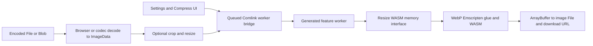

# R7 Squoosh independent reverse-engineering evaluation

**Disposition: PASS_WITH_GAPS.** All three independent integrations produced exactly matching outputs on the 26 frozen positive workflows. A and B received mechanical scores of 30/30. C received 29/30 because the evaluator failed to recognize its correctly observed input-decoding rejection. That raw score is preserved alongside the independent classification audit. REA supplied useful identity-bound WASM evidence; this run demonstrated no improvement in reconstructed functionality or overall architecture completeness.

Only R7 was executed. R5 and R6 were excluded by the owner. R1-R6 evidence was not modified by this mission. No publication, deployment, SAP access, production change, global configuration change or signing-key export occurred.

## What was reconstructed

Three fresh Codex investigator conversations independently implemented a browser API that accepts encoded image bytes, decodes to RGBA, optionally resizes, forwards WebP settings, invokes the pinned codec, and returns actual encoded bytes, MIME type and an adjusted filename. Each supplied an entry script, an independent worker and an evidence-backed architecture report. The evaluator executed their submitted bytes without repairing them.

The original individual WebP glue/WASM and resize WASM were permitted dependencies. The original application and feature-worker bundles were unavailable in reconstruction runtime. Independent source reviews verified that none of the three submissions delegated to that original pipeline or substituted fixture pixels. Vanilla browser JavaScript was actually loaded and executed; these are working bounded integrations, not architecture-only proposals.

This does not reconstruct the compression/resampling algorithms, the complete Squoosh application or its interactive editor. Export validation covers returned image bytes, MIME and filename; the original UI's actual download was separately smoke-tested. Other codecs, vector/HQX/browser resize modes, animation, color-profile/orientation edge cases, large-input behavior, full UI validation, persistence, stale-result cancellation and production operation remain outside the scored integration.

## Source, build and tools

| Identity | Observed pin |
|---|---|
| Source | [GoogleChromeLabs/squoosh](https://github.com/GoogleChromeLabs/squoosh/tree/e8d35e0fb66eb16eff6fe8fc773eabcbb7128de3), commit `e8d35e0fb66eb16eff6fe8fc773eabcbb7128de3` |
| Build | Original package 2.0.0; Node 20.16.0; unchanged lockfile; 823 installed packages; lifecycle scripts disabled; offline production build succeeded in 39.29 s |
| Artifact | 79 pinned production files; `frozen/artifact-manifest.json`; checked-in original WASM, workers and generated JS/assets |
| Lockfile SHA-256 | `089a94a8ed482275f8379b2094e6da4cda42f98aa9ee8315275b48c5199d8548` |
| Browser | Chrome for Testing 151.0.7922.34; Playwright 1.62.1; clean profiles; blocked service workers and outside requests |
| Analysis | Node 22.22.1; WABT 1.0.42 in both B and C; direct Acorn 8.12.1 in B |
| REA | 6.5.0; locally built source commit `742b6f587f3c4ef1b8212e7376d6f3a305b194dc`; prior pinned runtime mounted read-only |
| Model | gpt-6.1-sol, effort low, same configuration for A/B/C; Codex CLI 0.160.0 |

The reference is a fresh local original production build, not a claim of byte identity with today's hosted squoosh.app or an independently rebuilt libwebp algorithm. Source/license review, codec build pins and limitations are in `evaluator/REFERENCE_REVIEW.md` and `ATTRIBUTION.md`. Apache-2.0, WebP redistribution/endorsement conditions and resize MIT notices were retained with the source and codec subset. This was not a full transitive commercial redistribution audit.

Build/acquisition evidence is under `evidence/`, with exact provenance in `evidence/provenance.json`. The original browser UI loaded a synthetic PNG, selected WebP, downloaded and decoded a real 64x48, 302-byte WebP. See `arms/preflight/output/browser-inspect2.stdout.txt`, `inspect.png`, `inspect.html` and `inspect-output.webp`. The attempted Analytics request was blocked. No personal images or accounts were used.

## Reference architecture and frozen oracle

Production also has lazy initialization, SIMD selection, module caches, cancellation/idle worker lifecycle, persistence and result publication guards. The independently submitted integrations implement a smaller execution path. Architecture obligation ratings distinguish those missing explanations from passing functional behavior.

The evaluator observed 30 meaningful scenarios twice before valid investigation: 26 positive cases matched input, encoded-output and decoded-RGBA hashes; four negative cases consistently rejected. Cases cover PNG/JPEG/WebP decoding, misleading filename, transparency/lossless/near-lossless, one-pixel/odd/portrait dimensions, down/up resizing, centered crop, four resize kernels, premultiplication and linear-RGB flags, quality/method/alpha/sharp-YUV/filter settings, invalid codec settings and corrupt image input.

These are browser-decoding plus actual production-worker processing-boundary scenarios, not 30 complete UI interaction tests. Invalid encoder values were exercised at that boundary; full UI rejection/recovery is not established. Synthetic inputs, full options and actual expected outputs remain in evaluator-only `scenarios.json`, `reference1.json` and `reference2.json`.

The oracle, rubric, prompt and original adapters were hashed before investigation in `frozen/experiment-freeze.json`. The data-dispatch amendment was additively pinned in `frozen/run-freeze.json`. No hidden case, expected output, scoring obligation or investigator code was changed in response to results. Exact byte equality is justified for this fixed-browser, same-binary, same-options experiment by repeated reference equality; it is not a universal rule for lossy codecs.

## Independent outcomes

| Arm | Positive exact matches | Raw accepted negative cases | Raw mechanical score | Architecture FULL / PARTIAL / UNKNOWN |
|---|---:|---:|---:|---:|
| A: standard asset inspection | 26/26 | 4/4 | 30/30 | 16 / 9 / 5 |
| B: direct WABT + Acorn | 26/26 | 4/4 | 30/30 | 16 / 13 / 1 |
| C: REA WABT + JS analysis | 26/26 | 3/4 | **29/30**, with documented false negative | 14 / 11 / 5 |

All three had zero INCORRECT and zero NOT_OBSERVABLE architecture ratings. These are unweighted categories across 30 frozen factual obligations, not fidelity percentages or a composite capability score. An independent evaluator agent checked source/actual records against the fixed rubric, separately from investigator self-reports. Ratings remain model-assisted judgment, not blinded human-gold measurements or a cross-rater reliability study. See `evaluator/ARCHITECTURE_A.json`, `_B.json`, `_C.json` and their Markdown explanations.

Immutable submission copies and hash manifests are in `evaluator/submissions/A`, `/B`, `/C`; actual runs, decoded images and check-level results are in `evaluator/results/`. All positive cases required the same input hash, correct MIME/filename, RIFF/WEBP header, decoded dimensions, exact encoded bytes and exact decoded pixels. The three invalid codec settings were rejected by all arms. Corrupt input was also rejected by all arms; C's wording exposed the classifier defect described next.

### C29: keep the raw score and the actual behavior distinct

C's `solution.js:12` rejects from native `Image.onerror` with `Error('Decoding error')`, before canvas extraction or worker construction. The retained hidden execution points to exactly that callback and carries the reconstruction-stage rejection witness. The frozen rubric requires decoding rejection and explicitly excludes error wording from comparison.

The validator's lexical pattern `decode|image|InvalidStateError` misses the word `Decoding`. Only its `decodeRejection` check is false; rejection, reconstruction attribution and no-timeout/crash checks are true. Independent audit confirmed that C satisfies the original semantic requirement. We have **not** overwritten 29/30, patched C, relaxed a hidden test, rerun it for a better outcome, or silently substituted a new aggregate score. The evidence supports all four expected rejection behaviors, with a raw mechanical grading gap. See `evaluator/C29_CLASSIFICATION_AUDIT.md` and the preserved C comparison/actual records.

## What REA contributed

REA capability was established by actual successful target analysis before C began and by C's own invocations. Preflight WebP inspection returned valid WAT/interface evidence with 23 imports and seven exports for SHA-256 `86ad63e3a82b3011a55779264042152bc37c99360ef9140dd8eed543b35c080a`.

C then inspected the actual resize WASM: zero imports, five exports, exact identity and typed ABI evidence supporting the ten-i32 resize call and stack-return bridge. Its retained evidence ID is `ev_05c633baa3d72e5f79309ad6917281a3fa46b0e11b019b1c92f7b80d025d3603`. This was useful, directly checkable evidence about an integration boundary. B recovered the relevant resize signatures through direct WABT; A recovered its needed bridge from bundled JS. The selected conventional allowlist omitted a simple hashing executable, so C's ready-made SHA-256 convenience must not be treated as unique knowledge unavailable to ordinary tooling.

C's actual REA JS analysis also succeeded (`ev_2fb161e24d229a5f50f1330e838a72a5765cd2496b20e17f9cfd666911b3d17c`). Its retained output was 4,236,812 characters; selected summaries were Electron-oriented and not informative for this browser codec, and 32 files were outside the selected analysis. Direct glue reading and browser execution still resolved operational questions. The reviewer also identified two report references to query stdout files that do not exist; the underlying facts were corroborated from the real retained REA record/RPC responses. These citation defects are recorded, not silently repaired in the submission.

Thus the observed increment is structured, identity-bound WASM evidence packaging. No functional reconstruction gain, overall architecture-completeness gain, unique recovery of the codec algorithm or general evidence-quality superiority was demonstrated. A/B/C correctness is not inferred from tool visibility, WAT length, AST size or confident explanations.

## Time, tokens and overhead

| Arm | Dispatched actions | Active seconds | Cumulative session input tokens | Cached input tokens, included in input | Output tokens |
|---|---:|---:|---:|---:|---:|
| A | 27 | 401.29 | 1,052,552 | 986,368 | 11,307 |
| B | 25 | 638.58 | 1,065,851 | 937,216 | 11,045 |
| C | 27 | 397.88 | 1,397,722 | 1,295,872 | 9,432 |

Ceilings were identical: 45 dispatched actions and 1200 active seconds. B retained the same conversation across the owner pause and two signing recoveries; its consumed actions/time were not reset. Pause wall time is excluded, while active signing stalls are included. B therefore provides no clean timing comparison against C. C and A differed by only about 3.41 seconds in this one ordered run. C consumed the most cumulative input tokens; output tokens alone would hide that cost dimension.

The CLI reports cumulative session usage on resumed calls. Summing those cumulative per-turn totals would overcount. Final metrics use the last cumulative total, independently corroborated against B's native session token events. Original driver sum fields remain as raw records and are not the reported totals. Cached tokens are a subset of input, not an additional token charge. Monetary billing and full coordinator/evaluator AI cost are UNKNOWN; no money-saving or cost-per-success claim is made.

GNU time CPU/max-RSS measurements are retained in `evidence/final-metrics.json`, scoped to CLI process trees. They exclude Windows MCP/browser resource use and are not whole-workstation peak measurements. Setup and tests are excluded from investigator elapsed. Recorded setup included a 24.26 s successful locked install, 39.29 s build, an earlier 74.32 s failed npm attempt, browser/library acquisition, a 16.19 s initial B tool-transport failure, and signed-dispatch/signing recovery. Download/preparation/coordinator cost is only partially timed. Failed attempts were preserved.

## Isolation, signing and review findings

All valid sessions used the same model, objective, frozen artifact and scoped JSON-action transport. No original source, evaluator expectations, peer outputs, source maps or outside network were provided to investigators. Native target tools used bwrap user/PID/mount/network isolation, read-only artifact mounts and separate scratch directories. Reconstruction mounted only the declared low-level codec subset. Denial probes verified absent source/oracle/host paths, rejected peer traversal, read-only writes and no outside routes. Model API transport remains a trusted coordinator channel; this is not isolation from the model provider or from pretrained knowledge.

Custom coordinator and executed submission scripts passed Authenticode verification against existing signer thumbprint `A98A2B0353CB7C086BEEC23A36FC4095DFB37844`. The paused historical unsigned partial file was preserved and never executed; signing completed before its use. Two in-process signing stalls were repaired with a separate signed signer subprocess and explicit signature readback, without weakening policy. Vendor launchers/packages followed their provenance path. No signing keys were created/exported.

Independent pre-evaluation harness review found an important error-attribution defect: output decoding failures could masquerade as reconstruction rejection. An evaluator-only stage witness and a malformed-output versus real-rejection canary corrected this before any hidden submission evaluation. The same adapter was used for A/B/C. Other pre-evaluation fixes preserved prior scratch output, attested flat clean state, captured fixture bytes before passing them to untrusted code, and required successful sandbox exit/complete unique case reports. Frozen scenarios/expected behavior were untouched.

The review also found generic `find -exec` could bypass the advertised no-shell signing gate inside the original OS sandbox. It was blocked before A/C; B's completed inspection audit contains only `ls`, `strings` and `grep`, with no exploit or unsigned custom execution observed. This earlier enforcement gap and adapter-version difference limit the comparison. The driver's 45-action cap, not the controller's looser internal ceiling, controlled valid runs. One page per reconstruction batch and noncancelling Promise.race timeouts remain limitations; no evaluated case timed out. B's resumed tool counters also reused some low-number stdout paths; RPC records and original artifact/source references remain authoritative for those observations.

## Claim boundary and closure

Supported: faithful original reference build; actual REA WASM/JS analysis; three independent working same-codec integrations; all 26 positive workflows matching exact encoded/decoded results; four observed rejection behaviors; separate architecture categories; useful structured WASM provenance; preserved failed attempts and observed token/time costs.

Unsupported: complete application/codec reverse engineering, universal REA superiority, architecture or accuracy improvement from this run, general speed/cost savings, 100% correctness, production readiness, an independent human audit, or cross-application conclusions. Order was B,A,C, sequential on one shared workstation, one valid run per arm; caches, sampling, method choices, owner pause and repairs confound causal claims. No repeated/counterbalanced runs were conducted within this mission.

The bounded experiment is executed and the evidence/reporting deliverables are complete with explicit gaps. **PASS_WITH_GAPS** preserves the grading, enforcement, timing, scope and external-validity limitations rather than forcing an unqualified qualification. No operational blocker requires owner troubleshooting. Stronger claims would require a separately authorized frozen experiment. Current next action: stop; owner review only. Private publication content is in `PUBLICATION_BRIEFING.md`; it has not been published.

Canonical measurements/signatures and final integrity inventory: `evidence/final-metrics.json`, `evidence/final-signatures.json`, `evidence/final-evidence-manifest.json` and its SHA-256 sidecar. `FINAL_STATE.json` and `CURRENT_CHECKPOINT.md` hold the terminal state.

Execution-action accounting is in evidence/final-action-accounting.json: top-level coordinator invocations against the authorized 250-action lane, with 79 nested investigator dispatches separately reported. It is not a count of every subprocess/evaluator-agent internal operation. No R5/R6 budget was transferred. Frozen source/reference and final evidence readback support closure.
