# Independent Squoosh WebP integration

Implemented `/output/solution.js` and `/output/solution-worker.js`. The classic script defines `window.reconstruct(request)`. It decodes the supplied encoded bytes, optionally resizes their actual RGBA pixels, encodes WebP with the supplied numeric settings, and returns bytes, MIME type and a `.webp` filename. Five self-chosen successful scenarios produced byte-identical outputs to the production-worker probes; two failure scenarios rejected. These are public observations, not hidden-evaluator results.

## Architecture

```mermaid
flowchart TD
  subgraph Production evidence only
    UI[Compress bundle: controls and codec defaults]
    DEC[Browser decode and canvas ImageData]
    RPC[util bundle: Comlink-style wrap/expose]
    FW[features-worker: method dispatch and lazy codec initialization]
    UI --> DEC --> RPC --> FW
    FW --> RS[Resize WASM bridge and optional centered crop]
    FW --> WE[WebP Emscripten encode bridge]
  end
  subgraph Independent runtime
    REQ[request.input encoded bytes and request.steps]
    MAIN[solution.js: Blob, createImageBitmap, canvas RGBA]
    WK[solution-worker.js: own message protocol]
    CROP[Optional centered crop and resize memory bridge]
    RW[squoosh_resize_bg-3d426466.wasm]
    AMD[Own minimal AMD adapter and SIMD selection]
    GLUE[Unmodified pinned webp_enc JS]
    WW[Matching pinned WebP WASM]
    OUT[Transferred WebP bytes, MIME and filename]
    REQ --> MAIN -->|transfer RGBA buffer and steps| WK
    WK --> CROP --> RW --> WK
    WK --> AMD --> GLUE --> WW --> OUT
    OUT --> MAIN
  end
```

Production app/feature-worker bundles are inspected evidence only. Neither is loaded, copied or called by the reconstruction. Reconstruction browser logs show only `/submission/solution-worker.js` workers, with no denied requests or console errors [B2, B4, B6].

## Component inventory and evidence

All offsets below are zero-based UTF-8 text character offsets returned by the supplied tools; the files are minified, so line numbers are generally not useful.

| Component | Observed role and exact evidence | Runtime reuse |
|---|---|---|
| `/artifact/c/Compress-4cf9ab5f.js` | WebP label, MIME, extension and complete defaults near offset 7344; WebP feature adapter near 37786; native `createImageBitmap` decode with codec fallbacks near 94626 | None |
| `/artifact/c/util-06ce6ead.js` | Entire 3331-character file read in action 20. `expose` handles method paths and Promise failures; errors serialize message/name/stack; `getContainOffsets` near 3167 computes centered source rectangle | None |
| `/artifact/c/features-worker-b8ee33b5.js` | AMD/bootstrap loader at offset 0; `R` at 96060 selects SIMD or scalar WebP glue, caches initialization, calls `encode(data,width,height,options)`, throws `Encoding error.` on falsy result | None |
| Same worker, offsets 114900-121487 | Resize allocation/view helpers, empty-import WASM initialization, filter ordering, contain crop, ten-argument WASM call, output copy/free and stack restoration; exposed method table | None |
| `/artifact/c/supports-wasm-threads-b0989f01.js` | Entire 586-character file read in action 12: SIMD selection uses `WebAssembly.validate` on a small SIMD module; thread checking is distinct | Capability-test meaning recovered; no module loaded |
| `/artifact/c/webp_enc-75623855.js` | Offset 0: AMD dependencies module/require/exports, factory with `.ready`, Emscripten memory views, `locateFile`; offset 18300-19390: runtime startup and `exports.default` factory | Original glue loaded unchanged |
| `/artifact/c/webp_enc-a8223a7d.wasm` | Scalar WebP codec paired with that glue | Original binary unchanged |
| `/artifact/c/webp_enc_simd-2d7d2456.js`, `webp_enc_simd-75acd924.wasm` | SIMD pair named in production `R`; selected through equivalent SIMD validation | Original pair unchanged when supported |
| `/artifact/c/squoosh_resize_bg-3d426466.wasm` | Action 23 binary header dump: WASM magic/version; export section around byte 0x120 names `memory`, `resize`, `__wbindgen_add_to_stack_pointer`, `__wbindgen_malloc`, `__wbindgen_free`; successful independent empty-import instantiation in browser validates usable ABI | Original binary; independent JS bridge |
| `/artifact/c/workerHelpers-3dfd8e3e.js` | Entire 1619-character file read in action 22: rayon initialization for OxiPNG workers | Outside selected path; not loaded |
| Other inventory assets | AVIF, JPEG XL, QOI, MozJPEG, WebP decode, WP2, rotate, quantize/HQX and OxiPNG assets listed by action 1 | Outside scope |

The binary inspection was limited to the relevant resize header/exports and actual browser execution. I did not disassemble or reconstruct the full native resampling or WebP algorithms.

## Execution and transformations

1. Validate the requested codec and sequence: zero or more resize steps followed by one `webpEncode`. Construct a `Uint8Array` from request input, then a MIME-labelled Blob. No generated or hidden pixels are used.
2. Decode through browser `createImageBitmap`, draw at native size onto a canvas, and obtain RGBA8 `ImageData`. The production native-decode branch is evidenced above. Close the bitmap after extraction. PNG, JPEG and WebP inputs were exercised.
3. Start a dedicated classic worker for this invocation; transfer the RGBA buffer with dimensions and steps. The independent protocol uses `{id:1,...}` and either `{id:1,bytes}` or `{id:1,error:{name,message}}`. It does not implement or reuse production RPC.
4. For a resize, map `triangle`, `catrom`, `mitchell`, `lanczos3` to indices 0, 1, 2, 3, exactly as the production worker's `$` array. Pass premultiply and linearRGB to WASM without replacing them with canvas interpolation.
5. `fitMethod:'contain'` in this artifact means a centered source crop to the destination aspect ratio, followed by resize. It is not letterboxing. Recover source rectangle using the production aspect comparison, round each rectangle value with `Math.round`, and copy whole RGBA rows. Other supported behavior is stretch.
6. Independently instantiate resize WASM with `{}` imports. Reserve a 16-byte return area via stack adjustment, allocate/copy input RGBA, then call `resize(returnArea,inputPointer,inputLength,sourceWidth,sourceHeight,destinationWidth,destinationHeight,filterIndex,premultiply,linearRGB)`. Refresh typed views after calls that can grow memory. Read returned pointer and byte length from the first two i32 slots, copy bytes out, free returned storage, restore stack in `finally`. Production bridge does not explicitly free input after resize; the integration follows that ownership convention. Input consumption is inferred from its bridge rather than independently proven by native allocator analysis. Worker termination also reclaims the instance.
7. Validate SIMD support, import only the matching pinned encoder glue, and provide a small AMD module/exports adapter. Supply `locateFile` for the matching WASM and `noInitialRun:true`; await the original factory.
8. Invoke original `module.encode(rgba,width,height,step.options)` with the complete settings object unchanged. Copy encoded bytes to independent storage before transfer. Reject on missing/empty result.
9. Transfer output to the main script, terminate the worker, and return `{bytes:Uint8Array,mimeType:'image/webp',filename}`. The filename replaces the last extension, or appends `.webp`. Export here means returning a real encoded file payload; a download UI is outside this integration.

WebP controls recovered from the artifact include: quality and effort (`method`); `target_size` and `target_PSNR`; spatial/filter controls (`sns_strength`, `filter_strength`, `filter_sharpness`, `filter_type`, `autofilter`); `partitions`, `segments`, `pass`, `partition_limit`, `preprocessing`, `show_compressed`; alpha settings (`alpha_compression`, `alpha_filtering`, `alpha_quality`); lossless settings (`lossless`, `near_lossless`, `exact`); and `image_hint`, `emulate_jpeg_size`, `thread_level`, `low_memory`, `use_delta_palette`, `use_sharp_yuv`. Defaults at offset 7344 include quality 75, method 4, near_lossless 100 and lossless 0. The solution does not substitute those defaults for supplied settings. Native glue/codec remains responsible for numerical interpretation and valid ranges. Settings must be finite numbers under this contract.

## Browser evidence

Reference results include actual input hashes, pre-encode RGBA hashes, encoded hashes and decoded output hashes. Reconstruction results independently include input hashes, output hashes and decoded dimensions/pixel hashes. Each successful paired case matched both encoded and decoded hashes, not only dimensions.

| Case | Behavior | Dimensions; encoded size | Matching encoded SHA-256 | Evidence |
|---|---|---|---|---|
| gradient-resize | PNG 64x48; lanczos3, stretch, premultiply/linearRGB enabled; lossy quality 75 | 32x24; 156 bytes | `e777365790249abb577110a1af7a9a5f138b6947dbb5553774ce33efa8b18aab` | B1/B2 |
| alpha-crop-lossless | PNG 63x47; centered contain crop, catrom; premultiply/linearRGB disabled; lossless/exact | 29x29; 894 bytes | `da9adda87990ad4d1b7ff8ebd0a32a71b6def08362ff9e2b7e1673521e0e152c` | B1/B2 |
| jpeg-triangle | JPEG 51x37; triangle; quality 42, method 2; altered filter, segment, partition, alpha, pass, low-memory and sharp-YUV options | 43x31; 190 bytes | `d58b3cd1b37633345de64104700fa108c25f4c255cf96c728483797271fcab98` | B3/B4 |
| webp-mitchell | WebP 35x27 alpha input; mitchell upsample; premultiply enabled, linearRGB disabled | 55x39; 296 bytes | `c1ad31dd2233f7c42337e75e87676391977b99239509fb6e1c54ce74ccba2efc` | B3/B4 |
| encode-only | PNG alpha 48x32; no resize; lossless/exact, near_lossless 65, quality 83 | 48x32; 1376 bytes | `2d9707e015c19c95ffbe2ffd4d1613118b727b9de4d6e3a1a18c670be2baff44` | B5/B6 |

Exact retained browser evidence files:

- B0: `/output/tool-009.stdout.txt`, production UI inspect. Observed WebP selection, resize enable control, quality/method/lossless/exact controls, Download links; real 302-byte 64x48 WebP export, hash `6771586a6dadf4c1d22d2189ed46e2e8bed1a09fcc2e7860064bb24b291a4ecb`.
- B1: `/output/tool-010.stdout.txt`, first production reference pair.
- B2: `/output/tool-016.stdout.txt`, same pair through independent reconstruction.
- B3: `/output/tool-018.stdout.txt`, JPEG/WebP references and failure probes.
- B4: `/output/tool-019.stdout.txt`, corresponding independent reconstruction.
- B5: `/output/tool-024.stdout.txt`, encode-only reference.
- B6: `/output/tool-025.stdout.txt`, encode-only reconstruction.

## Failure behavior and bounds

Negative quality (-1) caused `Encoding error.` in both production-worker and reconstructed paths [B3/B4]. Corrupt PNG failed native decoding before the production worker was reached; reconstruction rejected with `Couldn't decode image` [B3/B4]. This demonstrates rejection boundaries, not identical exception classes or stack text.

The independent implementation also rejects invalid sequences, nonnumeric/nonfinite WebP values, unsupported resize methods or fit methods, missing encoded output, worker errors and message errors. WebAssembly loading/instantiation/traps propagate through the worker error reply. Every main-thread worker completion or error terminates its dedicated worker. A 60-second worker watchdog rejects and terminates on processing timeout; that timeout path was not exercised.

Intentional integration limits: at most 64 MiB encoded input; 16,777,216 decoded/output pixels; worker dimensions must be integers in 1-16383. Empty input rejects. These are independent implementation bounds, not recovered production validation rules. Browser decode occurs before the pixel count can be checked and outside the worker watchdog, so this is not a hard bound on browser decoder allocation or wall time. Concurrent callers each get a worker; aggregate concurrency is not capped. Dimension/unsupported-method guard branches were inspected in submitted JS but not individually browser-probed.

## Scope, unknowns and codec reuse

Reconstructed feature: browser-supported encoded image input  optional WASM resize  WebP options  real encoded export payload, with independently written worker orchestration, loader adapter, crop handling and memory bridge. Codec reuse means original pinned individual WebP JS/WASM and resize WASM perform their existing algorithms. It does not mean the native codecs were reverse-implemented, nor that the production feature pipeline was called.

Outside scope: full Squoosh UI, comparison slider, persistence, caching/abort scheduling, service worker behavior, other codecs, rotation, quantization, metadata preservation, animation, nonnative decode fallbacks, browser-specific resize variants, and HQX. Production HQX first scales by a clamped integer factor and then uses catrom (worker offset range above), but its WASM is not in the permitted reconstruction runtime; this integration explicitly rejects it.

Unknown or untested: scalar fallback execution on a non-SIMD browser, every WebP option/range combination, target-size/PSNR convergence, thread_level behavior, very large images, malformed resize sizes in production, repeated resize chains, color-managed/EXIF-oriented images, cross-browser decode/color differences, allocation behavior after native traps, and exact native algorithm internals. Passing options directly preserves the codec's supplied meanings but does not establish exhaustive behavioral coverage. No evaluator, original source, source maps, peer results or external resources were accessed.

## Tool-use observations and software notices

Only supplied signed-dispatch CLI/browser tools were used; no shell/interpreter, built-in tools, agents or external tools. No specialist tools were supplied. Inventory, bounded text searches and paged reads gave the useful glue evidence without dumping full WAT/AST. Action 23 inspected actual WASM bytes. `write_file` actions 14 and 15 reported Valid signatures; more importantly the subsequent isolated browser runs executed both scripts and returned actual images. A successful write alone was not treated as execution evidence.

Production browser inspect/probes attempted an existing Google Analytics script which the harness blocked; this was unsolicited original-app behavior, not investigator network access. Production runs also logged blocked service-worker registration. Reconstruction runs recorded neither external attempts nor these warnings.

Software attribution retained: Squoosh production assets, WebP encoder glue/binaries, and Squoosh resize binary are reused as supplied, unchanged. No license or copyright notice was removed from any reused asset. Action 17 searched the scalar/SIMD encoder JS, scalar encoder WASM and resize WASM for copyright/license/permission/redistribution strings and returned exit 1 with empty output (no match, not a successful notice extraction); action 26 found no `Copyright` text in initial-app. The supplied inventory did not expose a license file. Consequently exact upstream license texts, ownership years and codec versions were not established from available evidence and are not fabricated here. Original embedded notices, if any beyond those searches, remain in the untouched pinned assets; this report and integration do not claim ownership of them or replace upstream licensing obligations.
