# Bounded Squoosh WebP integration reconstruction

Delivered `solution.js` (classic browser entrypoint) and `solution-worker.js` (independent worker). The reconstructed feature decodes supplied encoded image bytes using the browser, optionally resizes RGBA using the pinned resize WASM, passes request WebP settings into the pinned WebP encoder, and returns real WebP bytes, MIME type and a renamed filename. Three public fixtures produced byte-identical results to the production worker, including resize. This is an integration reconstruction, not a reconstruction of the codec algorithms.

## Architecture

```mermaid
flowchart TD
 subgraph Production_observed
  UI[Compress bundle: file and options UI] --> Decode[Browser decode / canvas RGBA]
  UI --> RPC[Comlink-like util proxy]
  Decode --> RPC
  RPC --> FW[features-worker dispatcher]
  FW --> Crop[contain center crop and rounded offsets]
  Crop --> RW[resize WASM via wasm-bindgen bridge]
  FW --> Select[SIMD capability selection]
  Select --> Glue[WebP AMD Emscripten glue]
  RW --> Glue
  Glue --> CW[WebP encoder WASM]
  CW --> Export[encoded buffer / download]
 end
 subgraph Independent_submission
  Req[window.reconstruct request] --> Native[Blob object URL / Image / canvas]
  Native --> Transfer[transfer RGBA ArrayBuffer]
  Transfer --> Own[own disposable worker and message protocol]
  Own --> Bridge[own crop and resize memory bridge]
  Bridge --> PinnedResize[pinned resize WASM]
  PinnedResize --> Own
  Own --> Loader[own minimal AMD registration and WASM validation]
  Loader --> PinnedCodec[unmodified pinned WebP glue and WASM]
  PinnedCodec --> Return[transfer copied bytes / return image.webp]
 end
```

The original app and feature-worker are inspection evidence only. Neither is loaded by the submission. Runtime dependencies are limited to `/c/webp_enc_simd-2d7d2456.js`, `/c/webp_enc_simd-75acd924.wasm`, scalar fallback `/c/webp_enc-75623855.js`, `/c/webp_enc-a8223a7d.wasm`, and `/c/squoosh_resize_bg-3d426466.wasm`. The submission's worker URL resolves relative to the loaded solution script, hence `/submission/solution-worker.js`.

## Component inventory and evidence

References below identify exact files, character offsets returned by the inspection tools, or retained tool logs. Offsets refer to decoded UTF-8 text as reported by those tools.

| Component | Role and evidence |
|---|---|
| `/artifact/index.html`, `initial-app-426aeb22.js` | Production page and initial application assets, inventory `/output/tool-001.stdout.txt`. These were not exhaustively analyzed. |
| `/artifact/c/Compress-4cf9ab5f.js` | Feature UI; WebP label, MIME, extension and complete default option object near offset 7358 (`/output/tool-008.stdout.txt`). Browser/native resize branch near 68244 and 68936 (`tool-006.stdout.txt`). Decode uses `createImageBitmap` when available and fallback image loading near 94626 (`tool-022.stdout.txt`). |
| `/artifact/c/util-06ce6ead.js` | Full 3331-character file read in `tool-007.stdout.txt`: proxy `APPLY` type 2, argument serialization, exception serialization, `expose`, `wrap`, and exact center-crop `getContainOffsets`. |
| `/artifact/c/features-worker-b8ee33b5.js` | Worker bootstrap/dependency loading and `noInitialRun` factory initialization at offsets 0-4500 (`tool-014.stdout.txt`). WebP function `R` near 96060 chooses SIMD or scalar, calls `.encode(data,width,height,options)`, throws `Encoding error.` on falsy result, returns `.buffer` (`tool-004.stdout.txt`). Resize bridge, kernel order, HQX branch, crop and dispatcher at 114900-121487 (`tool-003.stdout.txt`). |
| `/artifact/c/webp_enc-75623855.js` | AMD factory exported as `default`; accepts `wasmBinary`, supports `locateFile`, default pinned WASM URL, Emscripten typed heaps (`tool-009.stdout.txt`, offsets 0-3000). Promise-ready export confirmed at 18000-19390 (`tool-015.stdout.txt`). |
| `webp_enc_simd-2d7d2456.js` and matching WASM | SIMD codec assets from inventory; actually loaded by independent worker in successful browser execution. Scalar glue was directly inspected; SIMD factory compatibility was validated by execution. |
| `/artifact/c/webp_enc-a8223a7d.wasm` | 298327 bytes. `strings` output `tool-025.stdout.txt` includes `WebPConfig`, `encode`, numeric option names, `WebPImageHint`, `WEBP_HINT_*`, Emscripten memory-view types and `RIFF`/`WEBPVP8L`/`WEBPVP8X`. This supports the binding/format identification, not recovery of the encoder algorithm. |
| `/artifact/c/squoosh_resize_bg-3d426466.wasm` | 37052 bytes, SHA-256 `b63e9f90187a9f5cec9a7a9cfc15e68e9330979ac39a29258282c020780cd6ec`. REA/WABT validated it and found no imports; exports memory, resize, stack adjustment, malloc and free. Exact evidence in `tool-010.stdout.txt`, `normalized_result.interface` and `imports`. |
| Other codecs, HQX, quantize, rotate, service worker | Present in inventory or original dispatcher, outside implemented scope. `workerHelpers-3dfd8e3e.js` was read (`tool-005.stdout.txt`); it handles oxipng worker initialization, not this WebP path. |

## Execution flow and transformations

1. Validate codec and sequence: zero or more `resize` steps followed by one `webpEncode`. Reject other methods. Decode only `request.input.bytes`; no fixtures or generated pixels exist in the implementation. Blob MIME comes from the input. Native image loading and canvas produce RGBA8. The original prefers `createImageBitmap`; the submission uses its browser Image/canvas alternative. The tested PNG and JPEG inputs match production.
2. Transfer the RGBA buffer to a newly created independent worker. Its protocol has one request and one success/error response, rather than copying the production RPC system. Each invocation owns its worker, so independent calls do not share mutable codec state.
3. For resize, map `triangle`, `catrom`, `mitchell`, `lanczos3` to indices 0, 1, 2, 3. `stretch` retains the whole source. Production's `contain` is a centered source crop to the target aspect, followed by resampling; it does not add letterbox borders. For target aspect a=W/H: if a>sourceW/sourceH, crop height=sourceW/a and center vertically; otherwise crop width=sourceH*a and center horizontally. Round source offsets and dimensions independently as the production worker does. Copy rows into an independent compact RGBA allocation.
4. Instantiate resize with empty imports. Reserve 16 stack bytes, malloc/copy input bytes, call `resize(returnArea,inputPtr,inputLength,sourceW,sourceH,targetW,targetH,kernelIndex,premultiply,linearRGB)`. Its signature is ten i32 parameters and no direct return; REA confirmed this. Read pointer and byte length from two i32 entries in returnArea. Refresh typed views after the call to handle memory growth, copy output before freeing it, then restore the stack in `finally`. Input allocation handling follows the observed consuming glue call; no extra input free is introduced. Exact internal Rust ownership was not independently proved. A fresh instance per resize and worker termination bound retained state.
5. Fetch SIMD WASM and use `WebAssembly.validate` to choose SIMD, otherwise scalar. A small independent `define` implementation supplies `module.uri`, exports and an explicitly unsupported dependency resolver; `importScripts` loads only the individual codec glue. Supply WASM bytes to its factory and await readiness. This is not the original feature-worker loader.
6. Merge observed production defaults with the final step's options; supplied values take precedence, without renaming, clamping or converting numeric flags. All 27 known numeric options must be finite numbers. Call `encode(RGBA,width,height,options)`. Copy its returned typed byte array, transfer the new buffer, terminate the worker, return `{bytes:Uint8Array,mimeType:'image/webp',filename:...}`. Filename replaces the final extension with `.webp`. No browser WebP encoder substitutes for the pinned codec.

The exact observed defaults are embedded in the worker: quality=75; method=4; sns_strength=50; filter_strength=60; filter_type=1; segments=4; pass=1; alpha_compression=1; alpha_filtering=1; alpha_quality=100; near_lossless=100. target_size, target_PSNR, filter_sharpness, partitions, show_compressed, preprocessing, autofilter, partition_limit, lossless, exact, image_hint, emulate_jpeg_size, thread_level, low_memory, use_delta_palette and use_sharp_yuv default to 0. Numeric meanings remain those implemented by the original WebPConfig binding. Quality/lossless/effort and alpha controls are reflected by original UI evidence; other fields are preserved rather than reinterpreted. Their exhaustive valid ranges and internal algorithms were not reconstructed.

## Browser validation

The real app inspect succeeded (`tool-013.stdout.txt`): upload, WebP selection and download yielded a browser-decodable 302-byte 64x48 WebP named `inspect-input.webp`. Controls included resize enable, codec selection, quality 75, method 4, lossless and exact. Analytics was denied by the offline browser; service-worker registration was blocked. These messages did not prevent feature execution and are not evidence of permitted external access.

| Public fixture | Submission / production evidence | Observed outcome |
|---|---|---|
| PNG gradient 64x48  32x24, lanczos3, stretch, premultiply and linearRGB true, lossy quality 75 | `tool-018.stdout.txt` / `tool-019.stdout.txt` | Both 156 bytes; encoded SHA-256 `e777365790249abb577110a1af7a9a5f138b6947dbb5553774ce33efa8b18aab`; decoded RGBA SHA-256 `ce5d55d04733eb933547437012241b46ab1b39f7af381e8f1b4be3cc16e12da8`. |
| Alpha PNG 63x47  29x31, catrom, contain, premultiply true, linearRGB false, lossless/exact=1, method=6 | `tool-023.stdout.txt` / `tool-024.stdout.txt` | Both 934 bytes; encoded SHA-256 `a4469f91a1fb98bb9d68716ad4b85332617f32a5ac5f2251ff6bf3505602d036`; decoded RGBA SHA-256 `3892a07ae5426e2a3887338a054cfb324a57d5375713cd7985c981d7d51d04cc`. |
| JPEG gradient 64x48, no resize, quality 42, method 2, varied filters/segments/pass/alpha fields, low_memory=1, use_sharp_yuv=1 | `tool-023.stdout.txt` / `tool-024.stdout.txt` | Both 232 bytes; encoded SHA-256 `5a8ed8e859f92a9d2bb760d337ace6f77f9bfb0898f9249df6c6044b2c325abe`; decoded RGBA SHA-256 `06e4d2686a5a2765d42b18b6845c2c34cb6e3402b2f054189c19fb7078ad289e`. |
| Corrupt PNG | `tool-023.stdout.txt` | Submission rejects `Decoding error`; no synthetic fallback image. |
| Quality 101 | `tool-023.stdout.txt` / `tool-024.stdout.txt` | Both reject `Encoding error.`. Submission probe used merged defaults; production probe supplied full defaults with the same invalid quality. |

Input hashes also match between the paired successful probes, as retained in these logs. These are self-chosen public probes, not hidden evaluator results or a proof of universal equivalence.

## Failures, bounds and explicit unknowns

Submission rejects empty input, encoded input above 64 MiB, images above 16777216 pixels, invalid step order, unsupported resize methods/fit values, noninteger or nonpositive target dimensions, targets above 16383 on either axis or the pixel bound, empty rounded crops, nonfinite/non-numeric WebP values, falsy encoder output and malformed resize lengths. Codec range checking is delegated to the pinned codec, evidenced by quality 101 rejection. Worker exceptions are serialized as name/message and cause promise rejection; worker load errors and a 120-second worker timeout also reject. Worker termination occurs on success or failure; object URLs are revoked after decoding. Asset fetch/compile failures propagate. SIMD fetch failure does not silently select scalar; only SIMD validation failure selects scalar. Native decode itself has no explicit timeout.

Triangle and Mitchell mapping is statically evidenced but not browser-probed. Scalar fallback, WebP input decode, premultiply=false, target-size/PSNR constraints, animation, color profiles/EXIF edge cases, very large inputs, timeouts, repeated resize sequences and concurrent calls are untested. Synthetic fixtures do not establish identical browser color management across all images. Image elements versus production's preferred ImageBitmap may differ for edge cases. Original UI additionally has browser resize modes, vector handling and HQX; submission explicitly rejects these. HQX requires an asset unavailable during reconstruction, so it was not replaced with a different algorithm. AVIF/JXL/QOI and other codecs, rotation, quantization, UI preview/comparison, caching, download-link presentation and production cancellation scheduling are outside scope.

## Tool-use observations and notices

All work used signed controller actions. Inventory and bounded text search located the feature path without original source or source maps. Both specialist tools ran successfully: REA WASM/WABT returned exit 0, valid module and precise ABI evidence (`ev_05c633baa3d72e5f79309ad6917281a3fa46b0e11b019b1c92f7b80d025d3603`). This substantiated the empty-import instantiation and stack-return bridge. REA JS returned exit 0 with evidence `ev_2fb161e24d229a5f50f1330e838a72a5765cd2496b20e17f9cfd666911b3d17c` (`tool-011.stdout.txt`). Its 4236812-character static evidence was much larger than needed; root query was still verbose. Targeted summary/limitations queries (`tool-021.stdout.txt`, `tool-026.stdout.txt`) show its Electron-oriented summary was not informative for this browser codec and 32 other files were outside selected analysis. Static evidence explicitly does not prove execution. Direct glue reads and actual browser execution resolved the operational questions. Full WAT was retained but not dumped/read exhaustively. `write_file` returned Valid signatures for both scripts (`tool-016`, `tool-017`), and browser execution independently confirmed they worked. No agents, shell/interpreter commands, external accounts, source edits or oracle were used.

Codec reuse means the original individual WebP glue and encoder binaries implement compression, and the original resize binary implements resampling. Only loader, worker protocol, byte/pixel plumbing, crop logic, resize bridge, result packaging and bounds are independently integrated. No claim is made to have rewritten WebP or recovered complete resampling/entropy algorithms. Original low-level assets are referenced unchanged, preserving any embedded notices. A targeted copyright/license/permission/redistribution search in both WebP glue files and index.html found no textual matches (`tool-020.stdout.txt`, exit 1); the inspected scalar WASM strings likewise showed no license notice. No license file was present in the supplied top-level inventory. Attribution is retained here to Squoosh, WebP and Emscripten bindings; exact upstream copyright/license text and dependency versions remain unknown from the inspected production assets. No external license text or source was sought, and this report does not replace upstream licensing requirements.
